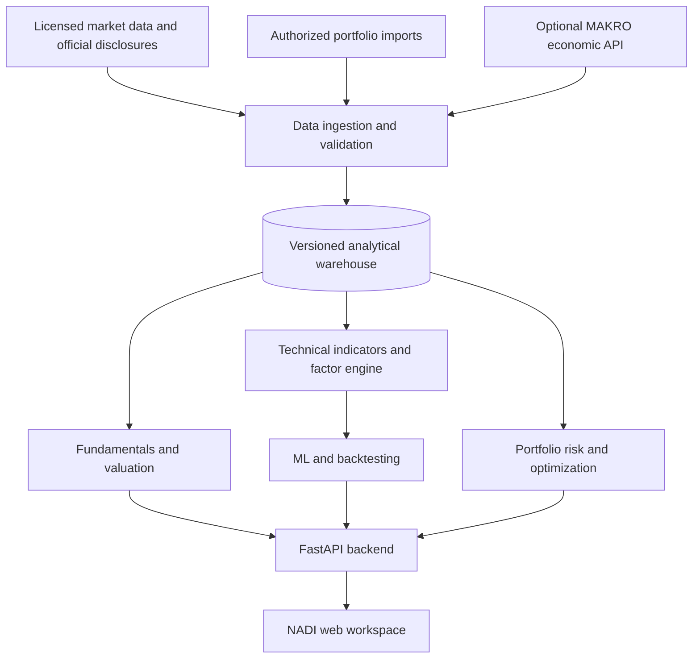

<div align="center">

# NADI

### The Pulse of Markets

**Feel the pulse. Read the markets.**

A stock intelligence platform combining quantitative finance, financial data science, machine learning, and portfolio analytics.


[Overview](#overview) · [Features](#planned-features) · [Architecture](#proposed-architecture) · [Roadmap](#roadmap)

</div>

## Overview

NADI is a portfolio project designed to turn fragmented stock market data into a unified research and investment analytics workspace. It aims to combine market monitoring, fundamental and technical analysis, systematic strategy testing, and portfolio risk management in one application.

Rather than relying on isolated indicators or unexplained buy/sell signals, NADI emphasizes transparent models, reproducible research, and measurable risk.

> **Project status:** Planned. This README describes the intended scope and architecture, not completed features or validated performance.

## Market coverage

| Market | Target exchanges | Reference indices |
| --- | --- | --- |
| Indonesia | IDX | IHSG, LQ45, IDX30 |
| United States | NYSE, Nasdaq | S&P 500, Nasdaq Composite, Dow Jones |
| Singapore | SGX | Straits Times Index |
| Mainland China | SSE, SZSE | SSE Composite, CSI 300, Shenzhen Component |

Actual instrument coverage, historical depth, and update frequency will depend on verified data access and licensing.

## Planned features

| Module | Capabilities |
| --- | --- |
| Market Intelligence | Market dashboard, heatmaps, breadth, sector rotation, watchlists |
| Stock Analysis | Interactive OHLCV charts, technical indicators, financial statements, peer comparison |
| Valuation Studio | DCF, DDM, residual income, comparable valuation, sensitivity analysis |
| Quantitative Scoring | Value, quality, growth, momentum, liquidity, risk factors, custom weights |
| Smart Screener | Multi-factor filters, saved screens, scheduled alerts |
| Unusual Trading Detection | Volume and price anomalies, liquidity risk, potential manipulation warning indicators |
| Order Flow | Bid/offer, broker summaries, foreign flows where legally available |
| Predictive Analytics | Return and volatility forecasting, market regimes, explainable model-based signals |
| Strategy Research | No-code strategy builder, backtesting, factor investing, robustness tests |
| Portfolio Intelligence | Multi-broker imports, performance attribution, FX exposure, optimization |
| Risk Management | Volatility, drawdown, VaR, expected shortfall, stress testing |
| News and Events | NLP sentiment, earnings calendar, dividends, corporate actions, event studies |
| Paper Trading | Simulated orders, trading journal, rebalancing and investment calculators |
| Data and MLOps | One-click synchronization, quality checks, model registry, conditional retraining |

Unusual-trading scores are research indicators, not evidence of market manipulation. Model-based signals are experimental analytical outputs, not guaranteed investment recommendations.

## Quantitative research

| Research area | Candidate methods |
| --- | --- |
| Factor investing | Cross-sectional ranking, factor portfolios, Fama–MacBeth regression |
| Forecasting | Random-walk baselines, Elastic Net, gradient boosting, GARCH |
| Market regimes | Hidden Markov models, clustering, change-point detection |
| Anomaly detection | Robust Z-scores, Isolation Forest, Local Outlier Factor |
| Strategy evaluation | Walk-forward backtesting, bootstrap, parameter sensitivity |
| Portfolio allocation | Mean–variance, risk parity, hierarchical risk parity, Black–Litterman |
| Explainability | SHAP, feature importance, ablation studies |
| Financial econometrics | Event studies, factor attribution, time-series regression |

Model selection will be based on out-of-sample evidence, not algorithm complexity.

## Proposed architecture



### Proposed technology stack

| Layer | Technologies |
| --- | --- |
| Frontend | Next.js, TypeScript, Tailwind CSS |
| Visualization | Lightweight Charts, Apache ECharts, Plotly |
| Backend | Python, FastAPI, Pydantic |
| Data | DuckDB, Parquet, PostgreSQL where needed |
| Analytics | Polars, Pandas, NumPy, SQL |
| Machine learning | Scikit-learn, XGBoost, LightGBM, SHAP |
| Econometrics | Statsmodels, Arch |
| Optimization | SciPy, CVXPY, PyPortfolioOpt |
| Testing and automation | Pytest, Vitest, Playwright, GitHub Actions, Docker |

The stack will be finalized during implementation. Dependencies will be introduced only when required.

## Data and automation

NADI is designed around a centralized, API-first data pipeline with authorized file imports as a fallback.

Candidate sources include SEC EDGAR, official exchange disclosures, licensed market-data APIs, permitted historical datasets, and the optional MAKRO API. Free access, redistribution, storage, and model-training permissions must be verified separately for each source.

The intended synchronization workflow is:

1. Check data availability, market schedules, and API quotas.
2. Retrieve new or revised records and corporate actions.
3. Validate OHLCV, currencies, timestamps, and instrument identifiers.
4. Publish validated data and refresh affected analytics.
5. Recalculate signals and portfolio exposures; retrain only when justified.
6. Record provenance, model versions, job status, and recovery checkpoints.

Every data view should distinguish real-time, delayed, end-of-day, historical, stale, and unavailable observations. Real-time coverage across all four markets is not assumed.

## Research integrity

- Prevent look-ahead bias, survivorship bias, data leakage, and train/test contamination.
- Use point-in-time fundamentals, corporate-action adjustments, and appropriate market calendars.
- Include trading fees, slippage, liquidity constraints, and execution assumptions in backtests.
- Benchmark against simple strategies and report unsuccessful experiments.
- Report uncertainty, risk-adjusted returns, and limitations; never fabricate performance metrics.
- Keep synthetic demonstrations separate from empirical research.

## Design philosophy

NADI represents the rhythm of financial markets through an expressive, colorful interface. The visual direction uses electric emerald, turquoise, spring lime, and complementary pastel accents, with pulse-inspired graphics and readable analytical workspaces.

| Color | Hex |
| --- | --- |
| Electric Emerald | `#008D70` |
| Fresh Turquoise | `#19C6A4` |
| Spring Lime | `#A0E36D` |
| Lemon Cream | `#FFF0B3` |
| Pastel Guava | `#FFD9D0` |
| Soft Lilac | `#DCCBFA` |

The design targets responsive layouts, accessible color contrast, light and dark modes, keyboard navigation, and meaningful charts. The landing page should have its own market-pulse composition rather than reuse the gradient-and-chart hero of other portfolio projects.

## Roadmap

- [ ] Foundation: repository, design system, architecture, tests
- [ ] Market data: source verification, ETL, persistent storage, automatic synchronization
- [ ] Market workspace: dashboard, heatmap, charts, stock details
- [ ] Company intelligence: fundamentals, valuation, financial statements
- [ ] Quantitative intelligence: screener, factor scores, anomaly detection
- [ ] Predictive models: forecasting, market regimes, model evaluation
- [ ] Research studio: backtesting, strategy builder, factor investing
- [ ] Portfolio: multi-broker import, attribution, optimization, risk analytics
- [ ] News and events: NLP, corporate actions, event studies
- [ ] Paper trading, alerts, reports, and model automation
- [ ] Production: security, accessibility, documentation, deployment, final audit

## Getting started

Clone the repository:

```bash
git clone https://github.com/IkkiRama/NADI-Stock-Intelligence.git
cd NADI-Stock-Intelligence
```

Installation instructions, environment configuration, and sample-data setup will be documented once the initial implementation is available. No API keys or broker credentials should be committed to the repository.

## Portfolio deliverables

The project aims to publish a live application, reproducible notebooks, SQL and ETL pipelines, model cards, a strategy backtesting report, a factor investing study, a portfolio optimization case study, API documentation, and a business intelligence dashboard.

## Disclaimer

NADI is an educational and quantitative research project. It does not provide personalized investment advice or guarantee returns. Backtested and simulated results may differ materially from live performance. No real-money trading is enabled by default. Market data and third-party content remain subject to their respective licenses.

## Author

**Rifki Romadhan** — Economics, Data Science & Software Engineering

[GitHub](https://github.com/IkkiRama)

---

<div align="center">
  <strong>NADI · The Pulse of Markets</strong><br>
  Part of the Data Science Portfolio series.
</div>
